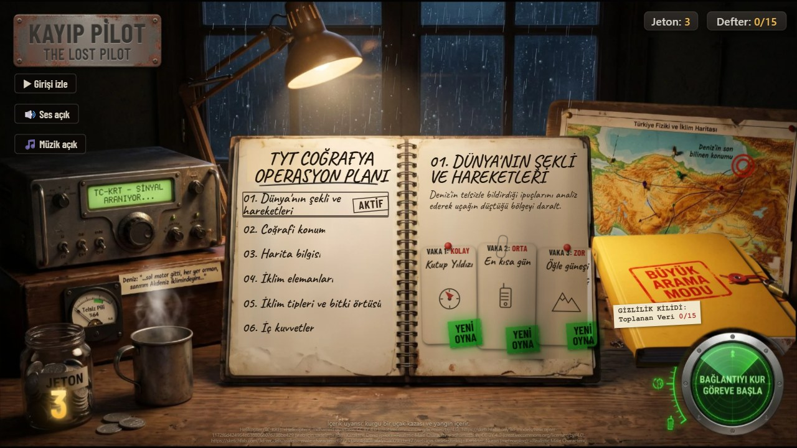
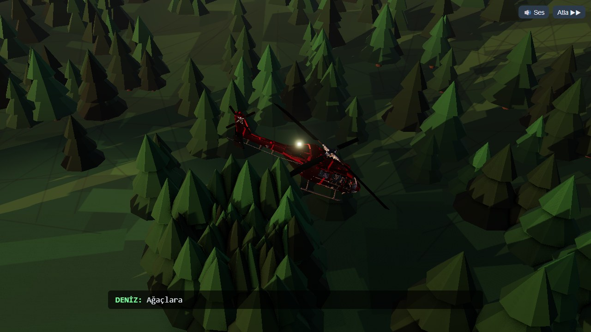
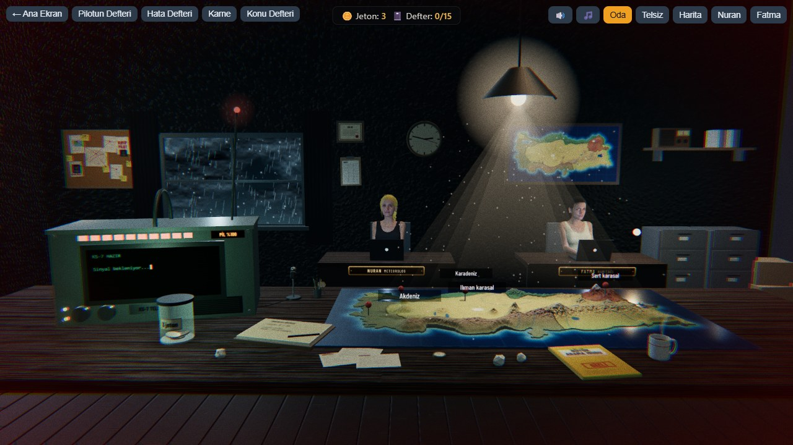
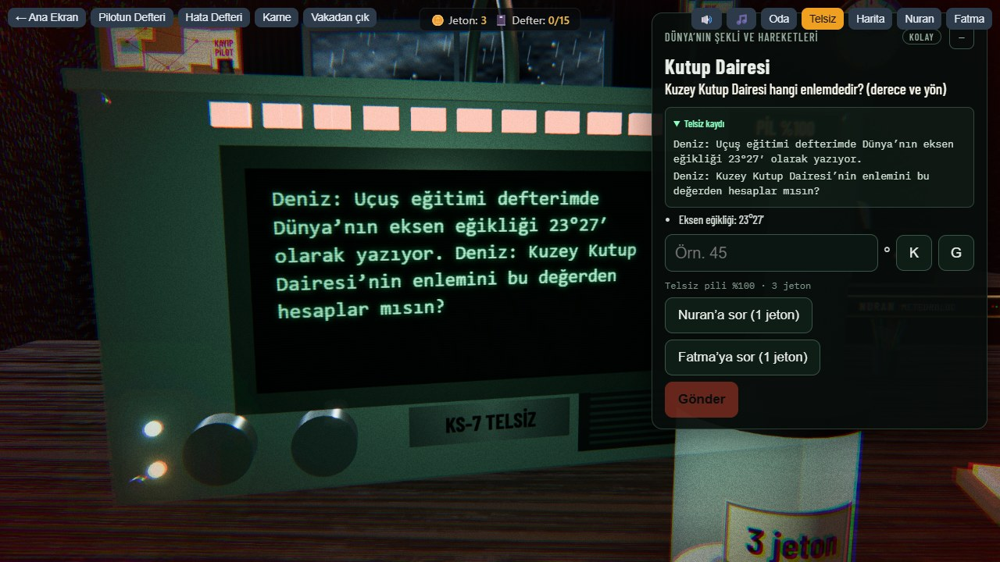

<div align="center">



# KAYIP PİLOT
### *The Lost Pilot*

**TYT Coğrafya çalışırken kayıp bir pilotu bul.**
Telsizdeki ses, defterdeki sayfalar ve masadaki harita: her doğru cevap Deniz'e bir adım daha yaklaştırır.


</div>

---

## Hikâye

Tıbbi malzeme taşıyan **TC-KRT** helikopteri radardan kayboluyor. Son telsiz kaydı: *"Mayday! Sol motor yangını… kuyruk kontrolünü kaybediyorum…"* Pilot **Deniz** sağ, ama nerede olduğunu bilmiyor. Elinde yalnızca uçuş okulundan beri tuttuğu defter var.

Sen, telsiz odasındaki arama ekibinin yanındasın. Deniz'in anlattığı her ipucu bir coğrafya sorusu: paralel, iklim, kayaç, akarsu rejimi, nüfus, ulaşım… Doğru çözdükçe telsiz netleşir, yağmur diner, ufukta şafak söker ve arama alanı daralır. Yanlış yaptıkça telsizin pili düşer, parazit artar.

<p align="center">
  
</p>

## Nasıl oynanır

1. **Konu seç.** Ana ekrandaki *TYT Coğrafya Operasyon Planı* defterinde 15 konu var. Her konuda kolay, orta ve zor vakalar bulunur.
2. **Telsizi dinle.** Vaka, Deniz'in telsiz mesajıyla başlar. Mesajlar daktilo gibi yazılır, sinyal bozuksa cızırtı girer.
3. **Çöz.** Cevap bazen bir seçenek, bazen bir sayı, bazen de **masadaki 3B Türkiye haritasına** işaret koymak ya da rota çizmektir.
4. **Kaynaklarını yönet.**
   - Yanlış cevap telsiz pilini **%5** düşürür; pil %50'nin altına inince parazit artar.
   - Doğru cevap **jeton** kazandırır. İpucu 1 jeton, pili doldurmak 2 jeton.
   - Ekipten **Nuran** (meteorolog) ve **Fatma** (haritacı) ipucu verir; kime sorulacağı sorunun türüne bağlıdır.
5. **Defteri doldur.** Çözülen her konu, Deniz'in defterine bir sayfa ekler. Defter iki sayfalı, sayfası çevrilen gerçek bir kitap gibi açılır.
6. **Büyük Arama.** Masadaki sarı dosyadan açılan modda altı aşamada Deniz'in yerini haritada tespit edersin.

Telsiz, çözdüğün vaka sayısına göre Deniz'in kilometre taşı mesajlarıyla cevap verir (1., 5., 10. … 45. çözümde).

## Ekran görüntüleri

<table>
  <tr>
    <td width="50%"><br><sub><b>Telsiz odası.</b> Nuran ve Fatma çalışma başında, masada kabartmalı Türkiye haritası, solda KS-7 telsizi.</sub></td>
    <td width="50%"><br><sub><b>Vaka paneli.</b> Telsiz kaydı, soru, cevap alanı, ipucu düğmeleri ve pil durumu.</sub></td>
  </tr>
</table>

## Özellikler

- **Sinematik açılış.** Helikopterin motor yangını, kuyruk rotorunun kontrolü kaybetmesi, ormana çarpma ve yere iniş. Sahne ve sesler kodla üretilir.
- **Canlı 3B oda.** Yağan yağmur, yanıp sönen LED'ler, klavyede yazan karakterler. Çözülen vaka sayısı arttıkça pencerede şafak söker, harita bölgelerinde izler birikir.
- **Gerçek yükseklik verili harita.** Türkiye haritası AWS/Mapzen arazi verisinden üretilmiş kabartmadır; dokununca enlem-boylam hesaplanır.
- **Yedi cevap türü.** Çoktan seçmeli, karar, grafik okuma, sayısal cevap, haritada bölge seçme, haritada nokta işaretleme ve rota sıralama.
- **Kendini ayarlayan zorluk.** Art arda yanlışta kolaya, art arda doğruda zora geçmeyi önerir.
- **Aralıklı tekrar.** Her vaka bir Leitner kutusuna girer (hemen, 1, 3, 7, 14 gün); *Karne*, hangi vakayı ne zaman tekrar etmen gerektiğini söyler.
- **Hata Defteri.** Yanlış yaptığın vakalar ayrı bir defterde birikir; *Karne* üzerinden tekrar edebilirsin.
- **Kodla üretilen ses.** Ana ekranda sakin bir pad, odada yağmur, uğultu, uzaktan gök gürültüsü ve telsiz paraziti; kaza anında katmanlı darbe, metal ve enkaz sesleri. Ses dosyası kullanılmaz (Web Audio). Ses ve müzik ayrı ayrı kapatılabilir.
- **Kalıcı ilerleme.** İlerleme tarayıcıda saklanır (`localStorage`), hesap gerekmez.

## Konular

| # | Konu | # | Konu |
|---|---|---|---|
| 1 | Dünya'nın şekli ve hareketleri | 9 | Su kaynakları |
| 2 | Coğrafi konum | 10 | Türkiye'nin yer şekilleri ve iklimi |
| 3 | Harita bilgisi | 11 | Nüfus ve yerleşme |
| 4 | İklim elemanları | 12 | Göç |
| 5 | İklim tipleri ve bitki örtüsü | 13 | Ekonomik faaliyetler |
| 6 | İç kuvvetler | 14 | Ulaşım |
| 7 | Dış kuvvetler | 15 | Doğal afetler |
| 8 | Kayaçlar ve topraklar | | |

45 vaka (konu başına kolay, orta, zor) ve 6 aşamalı Büyük Arama.

## Kurulum

Gereksinimler: **Node.js 20.19+** (veya 22.12+) ve **internet bağlantısı**. Telsiz odası sahnesi Three.js'i ve yazı tiplerini CDN'den yükler.

```bash
git clone https://github.com/emirmusakaraduman/kayip-pilot.git
cd kayip-pilot
npm install
npm run dev
```

Tarayıcıda <http://localhost:5173> açılır. Sesin başlaması için sayfada bir kez tıklamak gerekir (tarayıcı kuralı).

| Komut | Ne yapar |
|---|---|
| `npm run dev` | Geliştirme sunucusu |
| `npm run build` | Tip denetimi ve üretim derlemesi (`dist/`) |
| `npm run preview` | Derlenmiş sürümü yerelde açar |
| `npm test` | Vitest testleri (motor, veri, karne, hikâye, sinematik) |
| `npm run lint` | Oxlint |
| `node public/oda/tests/run.js` | Soru sistemi testleri (cevap doğrulayıcıları, vaka şeması) |

Geliştirme sunucusunda sinematiği belirli bir saniyeden başlatmak için: `/?sinema=22`.

## Mimari

Oyun iki parçadan oluşur ve bir köprüyle birbirine bağlanır:

```
┌──────────────────── React 19 + TypeScript (Vite) ────────────────────┐
│ Ana ekran · Sinematik (R3F/Three.js) · Karne · Konu Defteri · Defter │
│                                                                      │
│ Zustand deposu: pil, jeton, defter, istatistik (localStorage)        │
│        ▲                                                             │
│        │  window.ODA köprüsü (kpKopru.ts)                            │
│        ▼                                                             │
│ ┌────────────── iframe: public/oda ───────────────┐                  │
│ │ Telsiz odası: düz JS + Three.js r128            │                  │
│ │ Soru motoru (KP.engine) + cevap türleri + panel │                  │
│ └─────────────────────────────────────────────────┘                  │
└──────────────────────────────────────────────────────────────────────┘
```

- **React tarafı** menüleri, sinematiği, ilerlemeyi ve ödül/pil kurallarını yönetir.
- **`public/oda`** telsiz odasının 3B sahnesini ve soru sistemini içerir. Cevap doğrulayıcıları saf fonksiyonlardır ve Node'da test edilir; derleme gerektirmeyen düz script olarak yazılmıştır.
- Pil, jeton ve defter durumu her zaman React deposunda tutulur; iframe motoru olayları (`doğru`, `yanlış`, `durum`) köprüden bildirir.

### Klasör yapısı

```
src/
  App.tsx               sahne akışı: ana ekran → sinematik → oda
  cinematic/            açılış sinematiği (zaman çizelgesi, orman, parçacıklar)
  scenes/               OdaSahnesi, TelsizOdasi (iframe köprüsü)
  components/           AnaEkran, Karne, KonuDefteri, DefterKitabi
  game/                 motor, depo, karne, hikâye, ses (audio, muzik, sinematikSes)
  data/                 konular, vakalar, Büyük Arama, defter metinleri
  map/                  Türkiye yükseklik verisi
public/
  oda/                  3B telsiz odası ve soru sistemi (veri, testler, belgeler)
  models/               helikopter ve karakter modelleri (GLB, optimize edilmiş)
scripts/                GLB optimizasyonu, yükseklik verisi üretimi
docs/ekran/             bu belgedeki görüntüler
```

## Test

`npm test` 163 test çalıştırır: cevap motoru, vaka verisinin tutarlılığı, aralıklı tekrar, hikâye eşikleri, sinematik zaman çizelgesi ve varlık kaydı. Soru sistemi için `node public/oda/tests/run.js` 137 ek denetim yapar. Vaka içeriği kuralları `public/oda/docs/` altında belgelenmiştir.

## Varlıklar ve atıflar

3B modeller (helikopter ve karakterler) CC BY 4.0 lisanslıdır ve atıf oyunda başlık ekranında gösterilir. Ana ekran görseli proje sahibinin sağladığı referanstan türetilmiştir. Harita yükseklikleri AWS Terrain Tiles (Mapzen/Tilezen, SRTM) verisidir. Müzik ve ses efektleri kodla üretilir, dış ses dosyası yoktur.

Tüm kaynaklar, yazarlar, bağlantılar, lisanslar ve yapılan değişiklikler [CREDITS.md](CREDITS.md) dosyasındadır.

> **İçerik uyarısı:** Oyun kurgu bir helikopter kazası ve yangın içerir.

## Lisans

Bu depo için henüz bir yazılım lisansı belirtilmemiştir. Üçüncü taraf varlıklar kendi lisanslarına tabidir (bkz. [CREDITS.md](CREDITS.md)).
